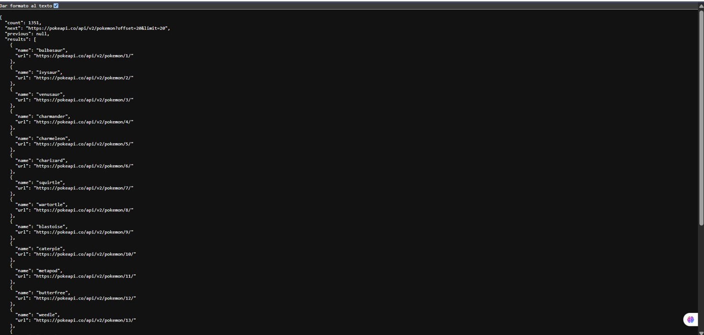
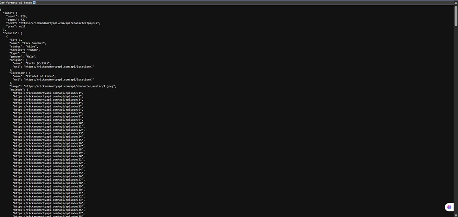
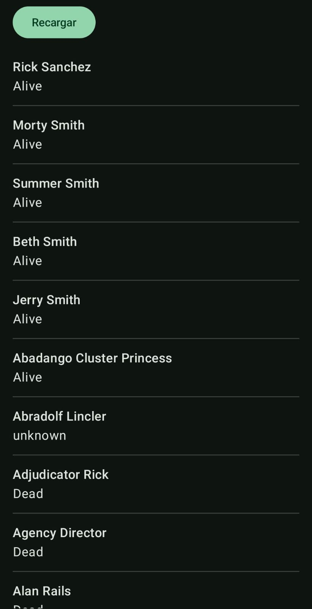
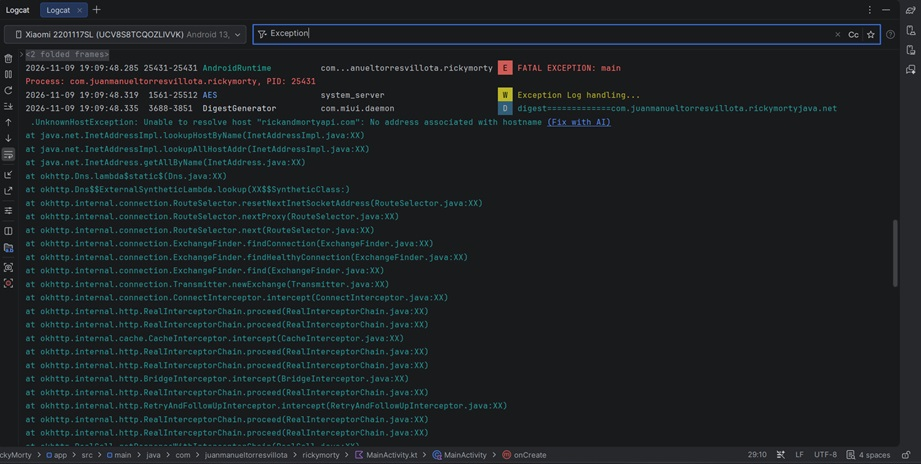
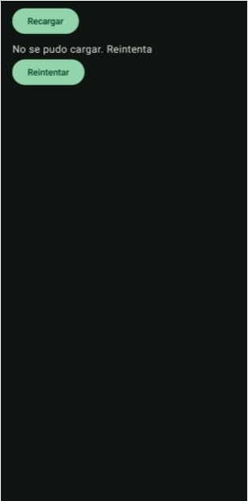
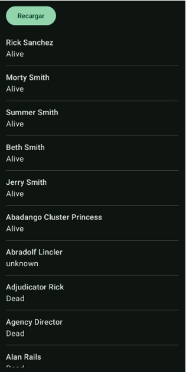
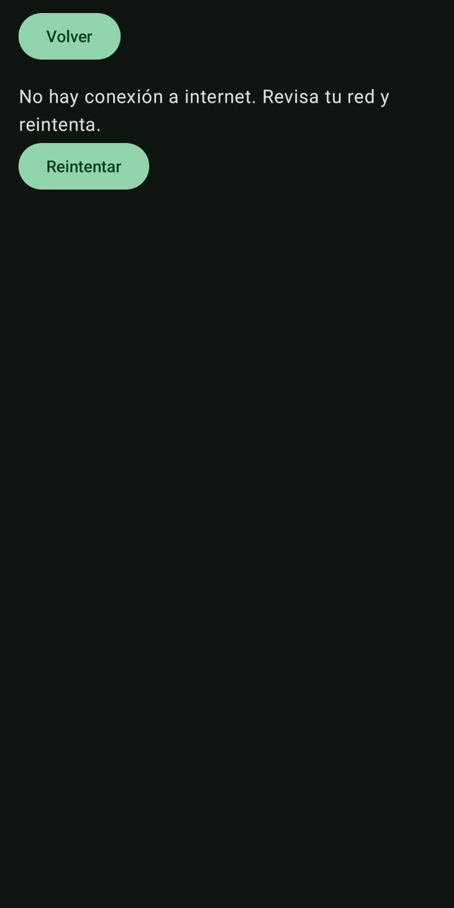
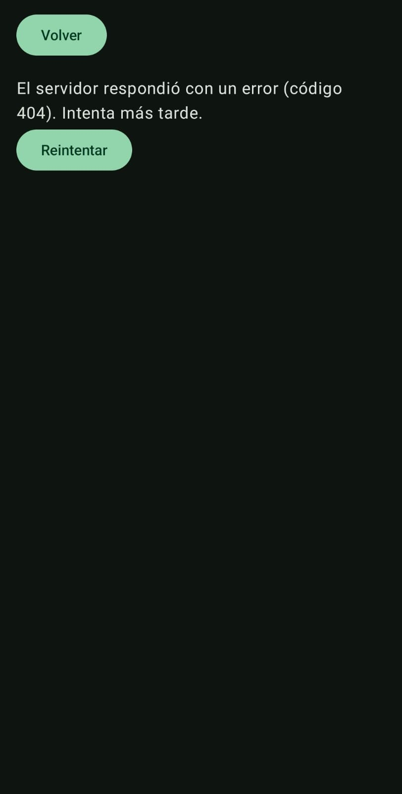

# Análisis — Taller 8: De la Pokédex guiada a Rick & Morty

Programación para Dispositivos Móviles — Universidad de Caldas
App: Kotlin + Jetpack Compose + Retrofit + Navigation Compose
API: https://rickandmortyapi.com/api/character
Dispositivo de prueba: Xiaomi 2201117SL (físico), Android 13

---

## 1. Predicción inicial (escrita antes del experimento)

> Pregunta: «Si el Repository llama a Retrofit sin try/catch desde `viewModelScope.launch`, y desactivo internet antes de volver a cargar, ¿qué ocurre y por qué?»

**Dada esa situacion, mi prediccion es que al momento de cargar la aplicacion sin internet, puede llegar a ocurrir 1 de 2 casos. O que la aplicacion crashee o que no ocurra nada**

---

## 2. Diferencia entre PokéAPI y Rick & Morty

Ambas respuestas tienen una lista llamada `results`, pero los objetos de adentro son distintos: en PokéAPI cada elemento solo trae `name` y `url` (hay que pedir esa `url` para obtener el detalle), mientras que en Rick & Morty cada personaje ya trae directamente `id`, `name`, `status`, `species`, `image` y más campos.

Además, el envoltorio cambia: PokéAPI usa `count`, `next` y `previous`; Rick & Morty usa un objeto `info` con `count`, `pages`, `next` y `prev`.

| | PokéAPI | Rick & Morty |
|---|---|---|
| Lista | `results` | `results` |
| Campos de cada elemento | `name`, `url` | `id`, `name`, `status`, `species`, `image`, ... |
| Datos de paginación | `count`, `next`, `previous` | `info { count, pages, next, prev }` |

Evidencia: `evidencias/0a_json_pokeapi.jpg` y `evidencias/0b_json_rickandmorty.jpg`

---

## 3. Evidencia de la app funcionando

### Lista real con internet (Evidencia 1)
La lista se carga desde la API y muestra nombre y estado de cada personaje.

### Detalle al tocar un personaje (Evidencia 2)
Al tocar una fila se abre el detalle con nombre, especie y estado.

---

## 4. Excepción observada en Logcat (Evidencia 3)

Versión temporal del Repository, sin `try/catch`. Con la lista ya cargada, activé el modo avión y pulsé **Recargar**.

- **Resultado:** la app se cerró (`FATAL EXCEPTION: main`).
- **Excepción exacta observada:**
  `java.net.UnknownHostException: Unable to resolve host "rickandmortyapi.com": No address associated with hostname`
- **Dónde apareció:** la línea de la excepción se vio en el registro de un servicio de MIUI (`DigestGenerator`, de `com.miui.daemon`), que copia el error del crash de la app. Es el mismo error que provocó el cierre. La pila de llamadas pasa por `InetAddress.getAllByName` y `okhttp3...`, es decir, el fallo ocurrió dentro de la petición de Retrofit/OkHttp.

---

## 5. Causa técnica

Sin internet, el sistema no puede resolver el nombre del servidor y lanza una excepción de red (`UnknownHostException`, una `IOException`). En la versión temporal esa excepción no se atrapaba en ningún sitio: salía de `Repository.obtenerPersonajes()`, subía al ViewModel y, al estar dentro de `viewModelScope.launch` sin `try/catch`, la corrutina terminó con error no manejado. Android lo trata como una falla grave de la aplicación y la cierra.

**Comparación con mi predicción:** mi predicción planteaba dos posibilidades: que la aplicación se cerrara o que no ocurriera nada. Lo observado fue la primera: la app se cerró con `FATAL EXCEPTION` al pulsar **Recargar** sin internet.

---

## 6. Corrección aplicada

1. El **Repository** envuelve la llamada a Retrofit en `try/catch` y devuelve un `Result`:
   - Éxito → `Result.success(respuesta)`
   - Fallo → `Result.failure(e)`
2. **`CancellationException` se relanza** (`throw e`) antes del `catch` general: es la cancelación normal de una corrutina (por ejemplo, cuando se cierra la pantalla) y no debe convertirse en un error de UI.
3. El **ViewModel** usa `fold`: si hay éxito publica `UiState.Success`, y si falla publica `UiState.Error("No se pudo cargar. Reintenta.")`. (Después, en el bonus de la sección 10, ese mensaje pasó a generarse con `mensajeDeError(it)`.)
4. La pantalla muestra, según el estado: `CircularProgressIndicator` (Loading), la lista (Success), o el mensaje con el botón **Reintentar** (Error).

### Estado Error sin internet (Evidencia 4a)
Con modo avión activado, la app ya no se cierra: muestra el mensaje y el botón Reintentar.

### Éxito tras recuperar la red y pulsar Reintentar (Evidencia 4b)

---

## 7. Diferencia entre error HTTP y fallo de conexión

- **`HttpException`:** el servidor **sí respondió**, pero con un código de error (por ejemplo, 404 si el personaje no existe). Hubo comunicación y llegó una respuesta HTTP.
- **`IOException`** (`UnknownHostException`, `ConnectException`, `SocketTimeoutException`...): **no hubo respuesta**. Falló el transporte: no hay conexión, no se resuelve el DNS o se agotó el tiempo.

Lo que observé fue `UnknownHostException`, o sea, un fallo de conexión (`IOException`) y no un error HTTP. No se debe a la ausencia del permiso `INTERNET`: con internet la lista cargó correctamente, así que el permiso está bien declarado.

---

## 8. Decisión de diseño del detalle

Implementé la **Opción A**: un `DetalleViewModel` con estados propios (`Loading`, `Success`, `Error`) que consulta `character/{id}` mediante el Repository.

- La navegación (Navigation Compose) envía **solo el `id`** (`detalle/{id}`), no el objeto completo; el ViewModel lo recibe por `SavedStateHandle`.
- **Si se abre la ruta de detalle sin lista previa**, funciona igual, porque el detalle pide sus datos por su cuenta. Con la Opción B (reutilizar un ViewModel compartido con la lista ya cargada) no habría datos en ese caso.
- Los Composables **no hacen peticiones HTTP**: la petición la hace el Repository, llamado desde el ViewModel.

---

## 9. Lista de verificación final

- [x] Permiso `INTERNET` declarado fuera de `<application>`
- [x] URL base termina en `/`
- [x] Claves del JSON verificadas (`id`, `name`, `status`, `species`, `image`)
- [x] Llamada `suspend` desde el ViewModel (`viewModelScope.launch`)
- [x] `CancellationException` relanzada
- [x] Sin `!!`
- [x] Estado Error con botón Reintentar
- [x] Detalle navegable
- [x] Evidencia antes / después (capturas 3, 4a y 4b)

---

## 10. Bonus: distinguir IOException y HttpException

Creé la función `mensajeDeError(e: Throwable)` (archivo `MensajesError.kt`), que usan los dos ViewModels en el `onFailure` del `fold`. Según el tipo de error, el usuario ve un mensaje distinto:

| Escenario | Excepción | Mensaje |
|---|---|---|
| Modo avión (sin conexión) | `IOException` (`UnknownHostException`) | "No hay conexión a internet. Revisa tu red y reintenta." |
| Personaje inexistente (`character/99999`) | `HttpException` (código 404) | "El servidor respondió con un error (código 404). Intenta más tarde." |

- En `IOException` **no hubo respuesta** del servidor: falló el transporte.
- En `HttpException` **sí hubo respuesta**, pero con un código de error.

Ambos escenarios los probé en la pantalla de detalle. Para provocar el `HttpException` cambié temporalmente la navegación para pedir `detalle/99999`, y luego la devolví a `detalle/$id`.

### Escenario IOException (modo avión)

### Escenario HttpException (404)

> Nota: las capturas 4a y 4b son anteriores al bonus, por eso 4a muestra el mensaje genérico "No se pudo cargar. Reintenta."
